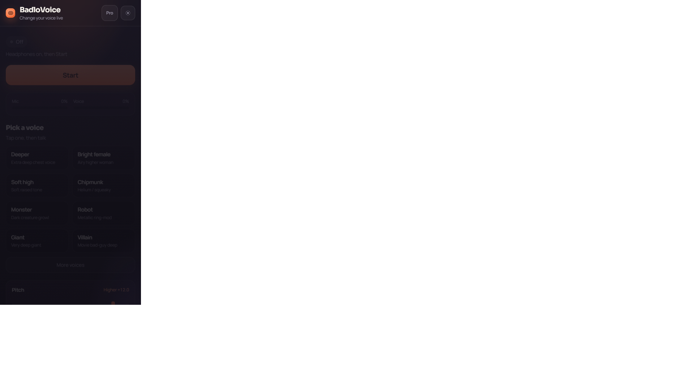

# BadloVoice

**Realtime AI voice changer** for browser and Android — change your voice live for Discord, games, streams, or calls.

Local by default: mic → DSP / RVC / ONNX → speakers or WAV. Your audio stays on your machine.

<p align="center">
  
</p>

<p align="center">
  <a href="#quick-start"><strong>Quick start</strong></a> ·
  <a href="#why-badlovoice">Why</a> ·
  <a href="#features">Features</a> ·
  <a href="#android-apk">Android</a> ·
  <a href="#virtual-cable-routing">Discord / VAC</a> ·
  <a href="#contributing">Contribute</a>
</p>

<p align="center">
  <a href="https://github.com/abuzar310/badlovoice/stargazers"></a>
  <a href="https://github.com/abuzar310/badlovoice/network/members"></a>
  
  
  
  
</p>

<p align="center">
  
</p>

<p align="center"><em>Simple mode (default): Start → pick a voice → talk. Pro mode unlocks the full studio.</em></p>

---

## Why BadloVoice

| You want… | BadloVoice |
|-----------|------------|
| Fast fun on phone | **Simple mode** — presets + pitch, no studio clutter |
| Serious conversion | **Pro studio** — RVC / ONNX models, slots, DSP rack |
| Discord / games | VAC routing guide built into the docs |
| Privacy | Processing stays **local** (no cloud voice upload) |
| Open source | **MIT** — fork, ship, contribute |

Built by studying and merging patterns from [OpenVoiceChanger](https://github.com/sioaeko/OpenVoiceChanger), [w-okada/voice-changer](https://github.com/w-okada/voice-changer), [Vonovox](https://github.com/dr87/Vonovox), and [echidna](https://github.com/supermarsx/echidna). See [ATTRIBUTION.md](ATTRIBUTION.md).

**Keywords:** realtime voice changer, RVC, AI voice conversion, Discord voice, Android voice changer, ONNX, local DSP.

---

## Features

| Area | What you get |
|------|----------------|
| **Simple mode** | Phone-first Start / voice presets / pitch / record (default UI) |
| **Pro studio** | Devices, VU + spectrum, latency modes, full effects rack |
| **Models** | Drag-drop `.pth` / `.pt` / `.onnx` + companion `.index` |
| **Model slots** | Hot-swap slots (w-okada style) |
| **DSP rack** | Gate, robot, whisper, telephone, distortion, bitcrush, chorus, echo, reverb, EQ, compressor |
| **DSP-only** | Pitch + formant + effects with no checkpoint |
| **RVC controls** | Pitch, formant, F0 (PM / Harvest / Crepe / RMVPE / FCPE), index, RMS, protect |
| **Recorder** | Capture converted audio → download WAV |
| **Offline convert** | Upload wav/mp3/flac/ogg/m4a → processed WAV |
| **Android** | Capacitor debug APK (`npm run apk` in `frontend/`) |

---

## Quick start

### Requirements

- Python 3.11+ recommended  
- Node.js 20+  
- Windows, macOS, or Linux  
- Optional: NVIDIA GPU + CUDA for faster RVC/ONNX  

### 60-second try (desktop)

```powershell
git clone https://github.com/abuzar310/badlovoice.git
cd badlovoice
python -m venv .venv
.\.venv\Scripts\Activate.ps1          # macOS/Linux: source .venv/bin/activate
pip install -r backend/requirements.txt
```

Terminal A — backend:

```powershell
python -m uvicorn backend.main:app --host 127.0.0.1 --port 8000
```

Terminal B — UI:

```powershell
cd frontend
npm install
npm run dev
```

Open **http://127.0.0.1:5173** → allow mic → **Start** → pick a voice → talk (headphones help).

> Pitch / DSP presets work without an RVC model. For full RVC, add HuBERT + a `.pth` (see [docs/MODELS.md](docs/MODELS.md)).

### Optional: RVC package + HuBERT

```powershell
pip install --no-deps git+https://github.com/RVC-Project/Retrieval-based-Voice-Conversion
```

Place HuBERT at:

```text
models/assets/hubert_base.pt
```

### Production (UI served by FastAPI)

```powershell
cd frontend
npm install
npm run build
cd ..
python -m uvicorn backend.main:app --host 127.0.0.1 --port 8000
```

Open http://127.0.0.1:8000

### First voice change

1. Allow mic access.  
2. **Simple:** Start → pick a voice → talk.  
3. **Pro:** load an RVC/ONNX model under Models, or stay DSP-only.  
4. Record WAV, or use **Converter** for whole files.  

---

## Android APK

Build a debug APK (Android SDK + Gradle required):

```powershell
cd frontend
npm run apk
```

Output: `frontend/android/app/build/outputs/apk/debug/`

iOS needs a Mac + Xcode (`npm run mobile:sync:ios`).

---

## Architecture

```text
Browser / Capacitor WebView (React + AudioWorklet)
    │  binary PCM frames + JSON settings
    ▼
FastAPI  /ws/audio
    │  gate → model (RVC/ONNX) or pitch DSP → effect rack
    ▼
Playback + optional WAV recorder
```

| Path | Role |
|------|------|
| `backend/` | FastAPI, WebSocket pipeline, models/slots/presets, DSP |
| `frontend/` | BadloVoice UI + Capacitor Android |
| `models/` | Your checkpoints + `assets/` (HuBERT, RMVPE, …) |
| `data/` | Runtime presets/slots/profiles (gitignored) |
| `docs/` | Models guide + screenshots |

---

## Virtual cable routing

For Discord, games, or OBS:

1. Install [VAC](https://software.muzychenko.net/freeware/vac470lite.zip) (often stabler than VB-Cable).  
2. Set mic + virtual line to **48000 Hz**, 1 ch, 16-bit when possible.  
3. BadloVoice **input** = real mic · **output** = Line 1 (VAC).  
4. In Discord/games, set microphone to Line 1.  

Remote GPU box: run the backend on the GPU machine; open the UI from your gaming PC.

---

## Configuration

Environment prefix: `SHIFTBOOTH_` (legacy name; still used in code).

| Variable | Default | Notes |
|----------|---------|--------|
| `SHIFTBOOTH_HOST` | `0.0.0.0` | Bind address |
| `SHIFTBOOTH_PORT` | `8000` | HTTP + WS port |
| `SHIFTBOOTH_MODELS_DIR` | `models` | Checkpoint directory |
| `SHIFTBOOTH_SAMPLE_RATE` | `40000` | Stream default |
| `SHIFTBOOTH_CHUNK_SIZE` | `4096` | Overridden by latency modes in the UI |
| `SHIFTBOOTH_HUBERT_PATH` | `models/assets/hubert_base.pt` | RVC content encoder |
| `SHIFTBOOTH_DEFAULT_LATENCY_MODE` | `balanced` | `ultra` / `balanced` / `quality` |

See `backend/config.py` for the full list.

---

## Project scripts

```powershell
npm run dev       # frontend Vite
npm run build     # frontend production build
npm run server    # uvicorn backend.main:app
```

Drive upload helper (optional, needs your own OAuth client — never commit secrets):

```powershell
.\.venv\Scripts\python.exe scripts\upload_apk_to_drive.py path\to\app.apk
```

---

## Star the repo

If BadloVoice helps you, **star the repo** — it helps others find a local, open voice changer.

[](https://star-history.com/#abuzar310/badlovoice&Date)

---

## License

MIT — see [LICENSE](LICENSE).

Upstream OpenVoiceChanger is MIT (Sioaeko). Other projects contributed design patterns; see [ATTRIBUTION.md](ATTRIBUTION.md).

## Attribution

| Project | Contribution |
|---------|----------------|
| [OpenVoiceChanger](https://github.com/sioaeko/OpenVoiceChanger) | Primary web stack: FastAPI, binary WS, AudioWorklet, DSP rack, RVC/ONNX |
| [w-okada/voice-changer](https://github.com/w-okada/voice-changer) | Model slots, crossfade/buffer, remote client idea |
| [Vonovox](https://github.com/dr87/Vonovox) | VAD/noise-gate assist, VAC guidance |
| [echidna](https://github.com/supermarsx/echidna) | Latency modes, settings profiles |

## Contributing

Issues and PRs welcome — see [CONTRIBUTING.md](CONTRIBUTING.md).

Good first areas: Simple UI polish, DSP presets, docs, Android packaging, Windows install scripts.
